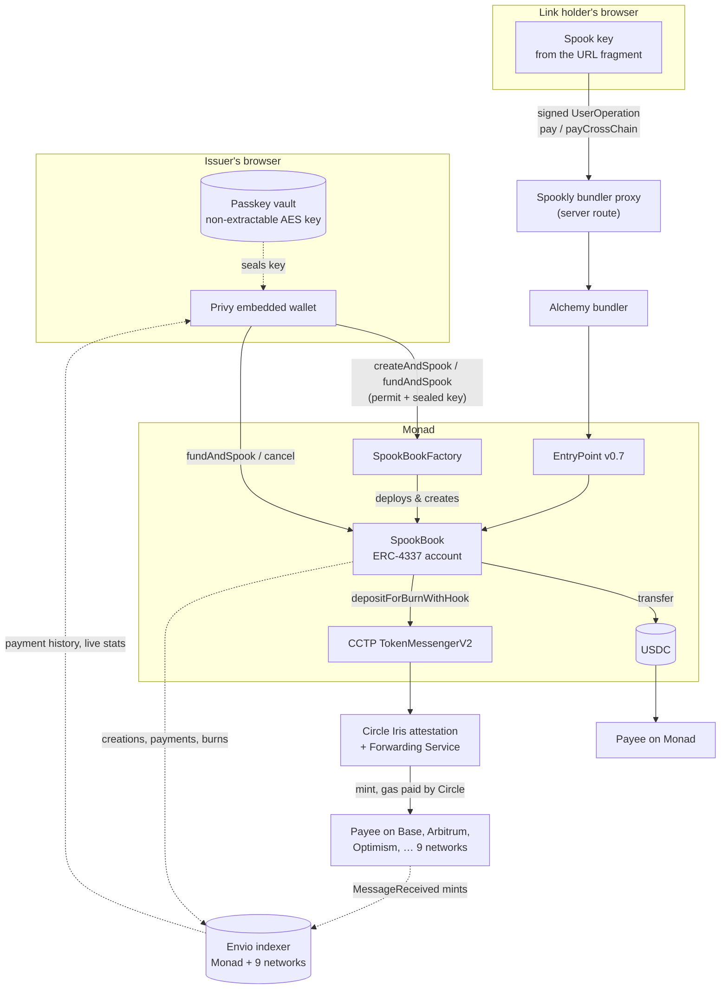
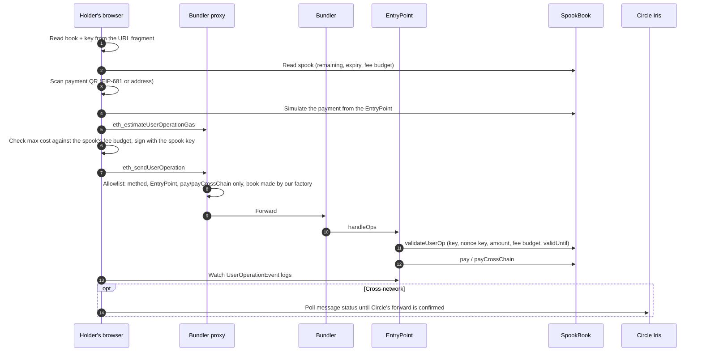

# Spookly — Spendable links

**Put USDC in a link. Whoever holds the link can pay any USDC address straight from it, on Monad or nine other networks, with no app, no wallet and no gas.**

Spookly turns a USDC payment into a _spook_: an amount set aside on Monad, dated, capped and cancellable, and shared as an ordinary link or QR code. The person holding the link scans a payment code, taps **Pay**, and the money arrives at the payee in seconds. They never set up a wallet, buy gas or "claim" anything first.

`Monad (mainnet or testnet, developer-configured)` · `ERC-4337 (EntryPoint v0.7)` · `Circle CCTP V2 + Forwarding Service` · `Passkeys (WebAuthn PRF)` · `Privy`

Mainnet and Aurora funding are configured in [`.env.example`](.env.example). See [local setup](#running-locally) for network and service configuration. Factory records for both environments are in `config/deployments/`; payments require an EntryPoint 0.7 bundler for the selected Monad network.

---

## Contents

- [Why](#why)
- [What it does](#what-it-does)
- [How it works](#how-it-works)
  - [Architecture](#architecture)
  - [A spook is a key, not a wallet](#a-spook-is-a-key-not-a-wallet)
  - [The spook book: an ERC-4337 account per issuer](#the-spook-book-an-erc-4337-account-per-issuer)
  - [Writing a spook in one transaction](#creation-a-spook-in-one-transaction)
  - [Spending a link](#spending-a-link)
  - [Paying across networks with CCTP](#paying-across-networks-with-cctp)
  - [Passkey-backed links: one passkey, many keys](#passkey-backed-links-one-passkey-many-keys)
  - [Issuer accounts and Monad-safe transactions](#issuer-accounts-and-monad-safe-transactions)
  - [Payment history across ten chains with Envio](#payment-history-across-ten-chains-with-envio)
- [Security model](#security-model)
- [Supported networks](#supported-networks)
- [Deployment](#deployment)
- [Tech stack](#tech-stack)
- [Running locally](#running-locally)
  - [Optional testnet sponsorship and wallet MFA](#optional-testnet-sponsorship-and-wallet-mfa)
  - [Installable spender](#installable-spender)
- [Testing](#testing)
- [Limitations](#limitations)

---

## Why

Sending stablecoins to someone who isn't a crypto user usually means a _claim link_. Before the money is usable, the recipient has to create a wallet or passkey, claim the funds into it, and then send them on again. Someone also has to pay for gas, and if the payee is on a different network the money is stuck where it landed. Whatever isn't spent sits in a wallet that may never be opened again.

Spookly removes the claiming step entirely. **The link itself pays.**

|                          | Typical claim link                               | Spookly spendable link                         |
| ------------------------ | ------------------------------------------------ | ---------------------------------------------- |
| Before it's usable       | Set up a wallet or passkey to claim it           | Nothing to set up. The link already pays       |
| Paying someone           | Claim it, then send it again from the new wallet | Scan their payment code, tap Pay               |
| Payee on another network | Stuck on the network it was sent on              | Delivered on 10 networks through Circle CCTP   |
| Gas                      | Someone funds or sponsors the new wallet         | Paid from the issuer's capped fee allowance    |
| Money left over          | Sits in a wallet that may never be opened again  | Cancel any time; it returns in one transaction |
| If the link leaks        | Whoever claims first takes everything            | Capped, dated and cancellable until spent      |

## What it does

**For the issuer** (signs in with Google, email or a wallet):

1. **Spook.** Type an amount and choose how long the spook lasts (1, 7 or 30 days). One transaction escrows the USDC, tops up the fee allowance and creates the spook, so it can't bounce.
2. **Share.** Copy the link, share it from the phone's share sheet, or show its QR code.
3. **Manage.** Watch each spook's remaining balance, cancel it at any time to get unspent USDC and fees back, and send or receive USDC from the built-in wallet.
4. **Restore anywhere.** With a passkey enabled, every link is backed up on-chain in encrypted form and reopens on any device the passkey syncs to.

**For the person holding the link** (no account, no app):

1. Open the link. It goes straight to the camera and shows the spook's balance and expiry.
2. Scan a USDC payment QR code, or enter an address and pick its network.
3. Check the amount and fee, then tap **Pay**. Progress is shown live until the payee has the funds: about 10 seconds on Monad, and about 15–30 seconds on other networks.

## How it works

### Architecture



There is no Spookly backend holding funds or keys. The only server code is a narrow relay that forwards spook payments to a bundler while keeping the bundler's API key private.

### A spook is a key, not a wallet

When an issuer creates a Spook, their browser generates a fresh, one-off secp256k1 key. The key's **address** is registered on-chain as the Spook's identifier, together with its amount, expiry and fee budget. The **key** goes into the link:

```
https://<host>/spook#<spook book address>.<spook key>      (both base64url-encoded)
```

Everything after `#` is the URL fragment, which browsers never send to a server. The spending key travels only from the issuer's device to the holder's device, through whatever channel the issuer chooses. Spookly's server never sees it.

The spook key is deliberately weak. It can't hold funds or call arbitrary contracts. The only thing it can do is authorize a payment from its own spook, up to its remaining balance, before its expiry and within its own fee budget.

### The spook book: an ERC-4337 account per issuer

Each issuer gets one **SpookBook**, a minimal ERC-4337 smart account that holds the escrowed USDC for all their spooks. Payments from a link arrive as UserOperations, and the book's `validateUserOp` enforces the spook rules before any gas is spent:

- **Only payments.** The call data must be `pay(signer, recipient, amount)` or `payCrossChain(signer, domain, recipient, amount, maxFee)`, with no `initCode` and no paymaster.
- **The right key.** The operation must be signed (EIP-191 over the `userOpHash`) by the key of the spook named in the first argument.
- **Per-spook nonces.** The upper 192 bits of the nonce (the nonce key) must equal the spook's address. Each spook gets its own replay-protected sequence, so many spooks can be spent in parallel and a signature can never be replayed against another spook.
- **Expiry without timestamps.** ERC-7562 forbids reading `block.timestamp` during validation, so the expiry is returned as `validUntil` and enforced by the EntryPoint.
- **Fee fencing.** Each spook carries its own `gasLeft` budget. The operation's maximum cost, `(verificationGasLimit + callGasLimit + preVerificationGas) × maxFeePerGas`, must fit within it, and is charged against it. Operations that would certainly fail (an inactive spook, a zero amount, more than what's left) are rejected during validation, so a link holder can't drain the fee budget with failing requests.

Gas for every payment comes from the book's EntryPoint deposit, never from the holder. The book keeps two accounting totals:

- `reserved`: the USDC escrowed by live spooks. Whatever exceeds it is the issuer's `available()` balance.
- `committedGas`: the fee budget still owed to live spooks. Any deposit above it belongs to the issuer and is returned when a spook is cancelled.

| Function        | Who can call it        | What it does                                                                           |
| --------------- | ---------------------- | -------------------------------------------------------------------------------------- |
| `fundAndSpook`  | Issuer                 | Tops up the fee deposit, pulls only the USDC shortfall (via permit), creates the spook |
| `spook`         | Issuer or factory      | Registers a spook against already-available USDC                                       |
| `cancel`        | Issuer                 | Ends a spook, refunds unspent USDC and any spare fee deposit                           |
| `pay`           | EntryPoint (spook key) | Transfers USDC to an address on Monad                                                  |
| `payCrossChain` | EntryPoint (spook key) | Burns USDC through CCTP for delivery on another network                                |
| `list`          | Anyone                 | Returns every spook with its state and sealed key                                      |

A spook address can be created only once, so a cancelled link can never become spendable again.

### Writing a spook in one transaction

The issuer never sees an "approve" step or a separate funding step:

- **First spook.** `SpookBookFactory.createAndSpook` does everything at once: deploys the issuer's book, pulls the USDC with an **EIP-2612 permit** signature, deposits the fee allowance (sent as `msg.value`), and creates the spook.
- **Later spooks.** `SpookBook.fundAndSpook` pulls only the shortfall between the spook amount and the book's available balance. It tops up the fee deposit only when the spare deposit is below the per-spook allowance (0.3 MON).
- **Front-run permits.** A permit someone else already submitted doesn't break the create; the contract falls back to the allowance it created.
- **Key saved first.** The spook key is stored on the issuer's device before the transaction is sent, so a confirmed spook can never end up without its link.

### Spending a link



- **Payment codes.** The scanner understands plain addresses and EIP-681 requests (`ethereum:<token>@<chainId>/transfer?address=…&uint256=…`), including scientific-notation amounts. It warns when a code asks for a token other than USDC, and asks the payer to choose a network when the code's chain isn't supported.
- **Checks before signing.** The payment is simulated from the EntryPoint, and its maximum cost is checked against both the spook's fee budget and the book's deposit. Problems show up as plain-language messages instead of failed transactions.
- **Fees.** The UserOperation is built with viem's account-abstraction tools. Its fee includes a 50% base-fee buffer and a priority fee 20% above the bundler's quote, so it lands promptly.
- **Bundler proxy.** The proxy relays only bundler methods, only for EntryPoint v0.7, and only `pay` or `payCrossChain` operations from spook books the factory created. It confirms the last point on-chain with `bookOf(owner) == sender`. The bundler API key is useless to anyone trying to relay anything else. Bundler errors such as AA21, AA22 and AA24 are turned into readable messages.
- **Confirmation.** The app reads the EntryPoint's `UserOperationEvent` logs directly, in 100-block windows to respect the public RPC limit. Confirmation doesn't depend on the bundler. A payment in progress survives page reloads.

### Paying across networks with CCTP

When the payee is on another network, `payCrossChain` calls Circle's **TokenMessengerV2** `depositForBurnWithHook`:

| Parameter           | Value                                                                                                                                                                   |
| ------------------- | ----------------------------------------------------------------------------------------------------------------------------------------------------------------------- |
| Finality            | Standard (`minFinalityThreshold = 2000`). Monad attests in about a block, and standard transfers from Monad carry no protocol fee                                       |
| Hook data           | `"cctp-forward"`, which invokes Circle's **Forwarding Service**. Circle submits the mint on the destination chain, so the payee needs no gas and no relayer is involved |
| `destinationCaller` | Zero, so the forwarder can complete the mint                                                                                                                            |
| `maxFee`            | The forwarding fee quoted by Circle's Iris API (`/v2/burn/USDC/fees/15/<domain>?forward=true`, median quote)                                                            |

The spook burns `amount + fee`, so **the payee receives exactly the amount requested**. The holder sees the fee before paying. After the burn, the app polls Iris (`/v2/messages/15?transactionHash=…`) for the attestation and the forward state, then links to the mint transaction on the destination explorer.

Verified on testnet: a spook key paid **0.50 USDC** from Monad to an address on **Base Sepolia** with a 0.063284 USDC forwarding fee. Burn to mint took **about 15 seconds**, and the holder paid **0 MON**.

- Burn on Monad: [`0x4630…7a3`](https://testnet.monadexplorer.com/tx/0x46309070f65d48d8574d28098e5f37458fa24d6becaa999ddd9a2738d0fa27a3)
- Mint on Base Sepolia: [`0xa412…446`](https://sepolia.basescan.org/tx/0xa4120e50e6ee672e427dcdf3e2348102bc190b8ce509aed21f8fe924b8fc5446)

### Passkey-backed links: one passkey, many keys

A link's key normally exists only on the device that wrote it. Spookly uses the **WebAuthn PRF extension** (through Category Labs' Mera library) so that one passkey protects every link:

1. **Derive.** The passkey evaluates PRF with an app-specific salt, `SHA-256("spookly.v1.spook-links")`. This produces a 32-byte secret that is identical on every device the passkey syncs to and unrelated to any other app.
2. **Split.** HKDF-SHA256 splits the secret into two keys that never sign anything:
   - an **AES-GCM-256 sealing key**, imported as a _non-extractable_ `CryptoKey` and kept in the browser's IndexedDB, so creation spooks needs no further prompts;
   - a **64-bit key id** that tells one passkey from another.

   The PRF output is zeroed straight after derivation.

3. **Seal.** Each new spook key is encrypted, `version (1) | key id (8) | nonce (12) | ciphertext + tag (48)` (69 bytes), and stored on-chain alongside the spook in the same create transaction. The contract treats it as opaque bytes, capped at 128. Every seal is decrypted and checked before the transaction is sent, so a faulty seal never reaches the chain.
4. **Restore.** On a new device, one passkey prompt rederives the vault and opens **every** live spook sealed with that key id. Each decrypted key must control its spook's address before it's accepted. Restored keys are cached locally, so the prompt isn't repeated.

The backup handles failures safely:

| Situation                           | Behaviour                                                                                                                        |
| ----------------------------------- | -------------------------------------------------------------------------------------------------------------------------------- |
| Wrong passkey chosen                | Refused, because its key id matches none of the book's seals                                                                     |
| Prompt cancelled or timed out       | Clear message, with the option to try again or create a new passkey                                                              |
| Passkey lost                        | Create a new one for future spooks. Links locked to the old one can still be cancelled for a full refund                         |
| Browser without PRF support         | Detected before a passkey is created, so no unusable passkey is left behind                                                      |
| Corrupted local key or stored vault | Discarded and recovered from the on-chain seal                                                                                   |
| Sign-out                            | The vault and every key that has an on-chain backup are wiped from the device. Keys without a backup are kept so no link is lost |

Passkeys are bound to the site's domain, and new passkeys are named with their creation date so they can be told apart in the browser's picker.

### Issuer accounts and Monad-safe transactions

Optional bounded issuer gas sponsorship uses server-only configuration and operates on Monad testnet. Wallet authenticator MFA is optional in either environment. See [setup](#optional-testnet-sponsorship-and-wallet-mfa).

- **Privy sign-in.** Google, email or an existing wallet. Email and social sign-ins create an embedded wallet with no seed phrase. Wallet pop-ups are disabled, and the app's own buttons are the confirmation.
- **Gas checks for Monad.** Monad charges gas by the gas _limit_. It also includes a transaction that can afford its gas but not its value, then reverts it, so the gas is lost. Every issuer transaction is therefore estimated as if funded, using a balance state override because Monad refuses to estimate a short balance. The value plus `gasLimit × maxFeePerGas` is checked against the real balance before anything is signed.
- **Live balances.** Wallet and spook balances refresh every 10 seconds and whenever the tab regains focus.
- **Wallet screens.** The issuer can receive USDC and MON, and send USDC to any address on Monad or, through the same CCTP and forwarding route, to any of the nine other networks.

### Payment history across ten chains with Envio

The contracts hold each spook's current state, but not its history. An **Envio HyperIndex** indexer adds the history: it follows the spook books on Monad and Circle's CCTP MessageTransmitterV2 on all nine destination networks in a single indexer.

- **Spook books.** The factory's `BookCreated` event registers each new SpookBook as a dynamic contract. Its `SpookCreated`, `SpookCancelled`, `Paid` and `PaidCrossChain` events become `Book`, `Spook` and `Payment` entities.
- **Deliveries, proven on the destination chain.** Every CCTP mint emits `MessageReceived` carrying the original burn message. That message names the paying spook book as `messageSender`, the payee, the amount burned and the fee Circle actually took. A cross-network payment is marked delivered when its mint is indexed on the destination chain, with the payee's exact received amount and the mint transaction, without relying on Circle's API.
- **Linking burns to mints, in either order.** HyperIndex processes chains independently, so a mint on Base can be indexed before its burn on Monad. Each side waits under a shared key (paying book, destination domain, payee, amount burned), and whichever arrives second completes the payment.
- **Live totals.** A `Stats` entity counts spooks created, USDC paid out and cross-network deliveries. The landing page shows these, regenerated at most once a minute.

In the app, each spook's page lists its payments: amount, payee, network, and whether the payment was paid, is on its way, or was delivered, each linked to the right explorer. Monad and six of the destination testnets sync through HyperSync. Unichain, Linea and World Chain Sepolia sync over RPC.

The indexer is optional. Without `NEXT_PUBLIC_ENVIO_GRAPHQL_URL` the app works the same, without the payment list and live stats.

## Security model

| Threat                                        | Mitigation                                                                                                                  |
| --------------------------------------------- | --------------------------------------------------------------------------------------------------------------------------- |
| A link leaks                                  | It can only spend its own capped escrow before its expiry, and the issuer can cancel it instantly                           |
| Holder tries to overspend                     | `spend` checks the remaining balance, and validation rejects it before any fee is charged                                   |
| Holder floods failing operations to burn fees | Validation rejects operations that would fail, and each spook's fee budget is capped separately                             |
| Signature replay                              | The nonce key is bound to the spook's address; each spook has its own sequence                                              |
| Cancelled link reused                         | A spook address can be registered only once                                                                                 |
| Server compromise                             | Keys live in URL fragments and never reach the server. The relay forwards only `pay`/`payCrossChain` for factory-made books |
| Sealed keys are public on-chain               | AES-GCM under a key that only the issuer's passkey can rederive. Each opened key must match its spook's address             |
| Issuer funds                                  | Only the issuer can create, fund or cancel. A spook key can't move anything outside its own spook                           |

## Supported networks

| Network (testnet)   | Chain ID | CCTP domain | Route                     |
| ------------------- | -------- | ----------- | ------------------------- |
| Monad               | 10143    | 15          | Direct USDC transfer      |
| Base Sepolia        | 84532    | 6           | CCTP + Forwarding Service |
| Arbitrum Sepolia    | 421614   | 3           | CCTP + Forwarding Service |
| OP Sepolia          | 11155420 | 2           | CCTP + Forwarding Service |
| Polygon Amoy        | 80002    | 7           | CCTP + Forwarding Service |
| Avalanche Fuji      | 43113    | 1           | CCTP + Forwarding Service |
| Unichain Sepolia    | 1301     | 10          | CCTP + Forwarding Service |
| Linea Sepolia       | 59141    | 11          | CCTP + Forwarding Service |
| World Chain Sepolia | 4801     | 14          | CCTP + Forwarding Service |
| Ethereum Sepolia    | 11155111 | 0           | CCTP + Forwarding Service |

## Deployment

| Network       | Chain ID | SpookBookFactory                                                                                                                   |
| ------------- | -------- | ---------------------------------------------------------------------------------------------------------------------------------- |
| Monad mainnet | 143      | [0xe10fae40a38a35d25fd6e01819a9bd285307f396](https://monadscan.com/address/0xe10fae40a38a35d25fd6e01819a9bd285307f396)             |
| Monad testnet | 10143    | [0xd93f67d2735e3af22e699d65aeaa6147db2c9214](https://testnet.monadexplorer.com/address/0xd93f67d2735e3af22e699d65aeaa6147db2c9214) |

Factory records live in `config/deployments`. Each issuer's SpookBook is created on their first Spook and can be resolved with `bookOf(issuer)`. Deployment tooling verifies bytecode, constructor dependencies, chain identity, and an explicit maximum gas fee.

## Tech stack

| Layer       | Technology                                                                      |
| ----------- | ------------------------------------------------------------------------------- |
| Contracts   | Solidity 0.8.30, Foundry, OpenZeppelin, eth-infinitism account-abstraction v0.7 |
| Chain       | Configured Monad network, ERC-4337 EntryPoint v0.7, EntryPoint 0.7 bundler      |
| Cross-chain | Circle CCTP V2, Forwarding Service, Iris API                                    |
| App         | Next.js 16 (App Router), React 19, viem (incl. account abstraction)             |
| UI          | Tailwind CSS v4, shadcn/ui on Base UI, React view transitions                   |
| Accounts    | Privy (Google, email, external wallets, embedded wallets)                       |
| Passkeys    | WebAuthn PRF through Mera, Web Crypto (HKDF, AES-GCM), IndexedDB                |
| Indexing    | Envio HyperIndex v3 and HyperSync, multichain with dynamic contracts, GraphQL   |

## Running locally

**Prerequisites:** Node.js 22+, pnpm, and [Foundry](https://getfoundry.sh) for the contracts.

```bash
pnpm install
cp .env.example .env.local
pnpm dev                       # http://localhost:3000, app at /app
```

The site and the app share one deployment and are split by host: `spookly.xyz` serves the landing page and `app.spookly.xyz` serves the app, with spook links at `app.spookly.xyz/spook`. `proxy.ts` routes each host and redirects old `/app` and `/spook` URLs on the site to the app host. In development and on hosts without an app subdomain, such as preview deployments, the app stays under `/app`, because Privy's embedded wallet needs HTTPS or plain `localhost`.

Fill in `.env.local` before starting. Mainnet is the default; set `NEXT_PUBLIC_SPOOKLY_NETWORK=testnet` to use the recorded testnet deployment. Restart or rebuild after changing networks.

Add the app's origin to Privy. Configure `BUNDLER_RPC_URL` with an EntryPoint 0.7 bundler for the selected Monad network; an ordinary chain RPC cannot submit user operations. Optional RPC overrides must serve the same network. Aurora funding requires a server-side key from [Aurora Studio](https://studio.aurora.dev) and is available only on mainnet.

| Variable                                     | Needed for                       | Description                                                               |
| -------------------------------------------- | -------------------------------- | ------------------------------------------------------------------------- |
| `NEXT_PUBLIC_SPOOKLY_NETWORK`                | Environment                      | `mainnet` or `testnet`; shared by the app and developer tooling           |
| `NEXT_PUBLIC_PRIVY_APP_ID`                   | App                              | Privy app ID for issuer sign-in                                           |
| `AURORA_API_KEY`                             | Cross-chain funding              | Server-side Aurora Studio key; mainnet only                               |
| `BUNDLER_RPC_URL`                            | Payments                         | EntryPoint 0.7 bundler for the selected Monad network                     |
| `ALCHEMY_API_KEY`                            | Testnet payments                 | Optional fallback when the testnet bundler URL is unset                   |
| `MONAD_RPC_URL`, `NEXT_PUBLIC_MONAD_RPC_URL` | Optional                         | RPC overrides for the selected network                                    |
| `DEPLOYER_PRIVATE_KEY`                       | Broadcast deployment, smoke test | Key holding MON and, for the smoke test, USDC in the selected environment |
| `NEXT_PUBLIC_ENVIO_GRAPHQL_URL`              | Optional                         | Matching indexer endpoint for history and stats                           |
| `NEXT_PUBLIC_SITE_URL`, `NEXT_PUBLIC_APP_URL` | Optional                        | Site and app origins; default to `spookly.xyz` and `app.spookly.xyz`      |

On testnet, get funds from the [Circle USDC faucet](https://faucet.circle.com) and [Monad faucet](https://faucet.monad.xyz). Production hosting needs its own service credentials and matching indexer endpoint; local environment files do not configure the deployment host.

### Optional testnet sponsorship and wallet MFA

For gas sponsorship, configure Privy TEE wallets, enable sponsorship for Monad Testnet only, disable **Allow transactions from the client**, and leave swap-fee sponsorship off. Use an Upstash Redis database with eviction disabled. Set `PRIVY_GAS_SPONSORSHIP=true`, `PRIVY_APP_SECRET`, `UPSTASH_REDIS_REST_URL`, and `UPSTASH_REDIS_REST_TOKEN` in the server environment. Keep these credentials server-only; the client and server must use the same Privy app ID. Mainnet disables sponsorship regardless of this flag.

Sponsorship covers eligible issuer transaction fees, while the issuer supplies the Spook's USDC principal and MON allowance. Limits in `lib/server/sponsor-policy.ts` allow five reservations per wallet and Privy user per UTC day, and 100 across the app. Attempts count toward the limits. Disabling sponsorship stops new reservations; configured credentials and storage remain necessary to reconcile pending submissions.

Enable **Authenticator app** wallet MFA in Privy to offer optional enrollment through **Protect wallet**. Privy's signing flow handles verification automatically. Wallet MFA and the passkey used to back up Spook links serve separate purposes.

**Contracts:**

```bash
pnpm contracts:test      # Foundry tests against a fork of the configured Monad network
pnpm contracts:build     # compile and regenerate the app's ABI bindings
pnpm contracts:deploy    # read-only network and required-contract checks
pnpm contracts:deploy --broadcast --max-fee 0.5 # explicit MON gas budget; deploy and record the factory
```

Keep `DEPLOYER_PRIVATE_KEY` in ignored, permission-restricted `.env.deploy.local`, separate from app credentials. Every broadcast requires an explicit maximum fee budget. Commit the public factory record written to `config/deployments/`, then restart or rebuild the app.

**Indexer (optional):** needs Docker and a free [Envio API token](https://envio.dev/app/api-tokens) for HyperSync.

```bash
pnpm indexer:install
echo "ENVIO_API_TOKEN=<your token>" > indexer/.env
pnpm indexer:dev                                   # mainnet GraphQL on :8081; testnet on :8080
```

Then set `NEXT_PUBLIC_ENVIO_GRAPHQL_URL` to `http://localhost:8081/v1/graphql` for mainnet or `http://localhost:8080/v1/graphql` for testnet. The root command generates `config.generated.mainnet.yaml` or `config.generated.testnet.yaml` from the selected deployment. Mainnet uses a separate Docker volume and Postgres/Hasura stack on ports 5434/8081; testnet uses 5433/8080. Local mainnet database credentials stay in ignored `indexer/.env.mainnet.local`. Keep `config/deployments/mainnet-indexer.json` for reproducible destination start blocks. Hosted Envio needs the generated configuration and a separate database and endpoint for each environment.

**Fully local testnet fork:** set `NEXT_PUBLIC_SPOOKLY_NETWORK=testnet`, run `anvil --fork-url https://testnet-rpc.monad.xyz`, deploy using `--broadcast` with `MONAD_RPC_URL=http://127.0.0.1:8545`, start the bundled minimal bundler with `pnpm dev:fork`, then run the app with `NEXT_PUBLIC_MONAD_RPC_URL` and `MONAD_RPC_URL` pointing at anvil and `BUNDLER_RPC_URL=http://localhost:4337`.

### Installable spender

Deploy over HTTPS and open `/spook`. Use the browser's **Install app** action in supported Chromium browsers, or **Share → Add to Home Screen** in Safari on iPhone. The installed app opens an **Open spook** form; paste a Spook link to use it. Issuer pages do not advertise the spender manifest.

The spender requires an internet connection. Camera access, signing, and payment confirmation use the foreground flow. Installation and storage behavior vary by platform: an external Spook link may open in the browser, and an installed app may have separate pending-payment storage. Verify installation, camera access, and payment recovery on physical devices before release.

## Testing

| Command                       | What it covers                                                                                                                                                                                                                                                                                                                                                         |
| ----------------------------- | ---------------------------------------------------------------------------------------------------------------------------------------------------------------------------------------------------------------------------------------------------------------------------------------------------------------------------------------------------------------------- |
| `pnpm contracts:test`         | 30 Foundry tests on the selected Monad fork: one-transaction creations, shortfall-only funding, sealed-key storage, payments on Monad and burns for other networks, per-spook nonces, wrong-key and overspend rejection before fees are charged, cross-spook nonce misuse, cancellation refunds (keeping fees other spooks still need), expiry, and issuer-only guards |
| `pnpm test`                   | Aurora quote validation, funding deficits, session recovery, partial settlement and duplicate-payment guards. Passkey vault: deterministic derivation, sealing and opening, wrong passkey, tampered nonce or ciphertext, seals moved to another spook, malformed seals, restoring many links in one pass, corrupted local keys, and sign-out cleanup                   |
| `pnpm --dir indexer test`     | Indexer: decoding a real CCTP burn message, burn and mint keys agreeing across chains, non-matching payments, domain mapping                                                                                                                                                                                                                                           |
| `pnpm smoke`                  | End to end on real Monad testnet: creates a Spook, pays 0.5 USDC to Base Sepolia through the bundler, and waits for Circle's forwarder to deliver                                                                                                                                                                                                                      |
| `pnpm typecheck`, `pnpm lint` | TypeScript and ESLint                                                                                                                                                                                                                                                                                                                                                  |

## Limitations

- **Mainnet hosting setup required.** Configure mainnet credentials and indexer endpoints on the deployment host. Live Aurora funding requires a Studio key; the integration has not yet been verified with a live transfer.
- **Monad escrow.** Spooks are created and escrowed on Monad and pay out to ten networks. Aurora can fund the issuer from other supported chains.
- **Older links aren't backed up.** Links created before a passkey is set up stay on the device that wrote them. Those spooks can still be cancelled for a refund.
- **Passkeys are tied to the site's domain.** Passkeys belong to `spookly.xyz`, so they work on the site and the app subdomain, but links backed up on one domain can't be restored from another.
- **Fixed fee allowance.** Each spook reserves 0.3 MON for gas, and whatever it doesn't use is refunded on cancel.
