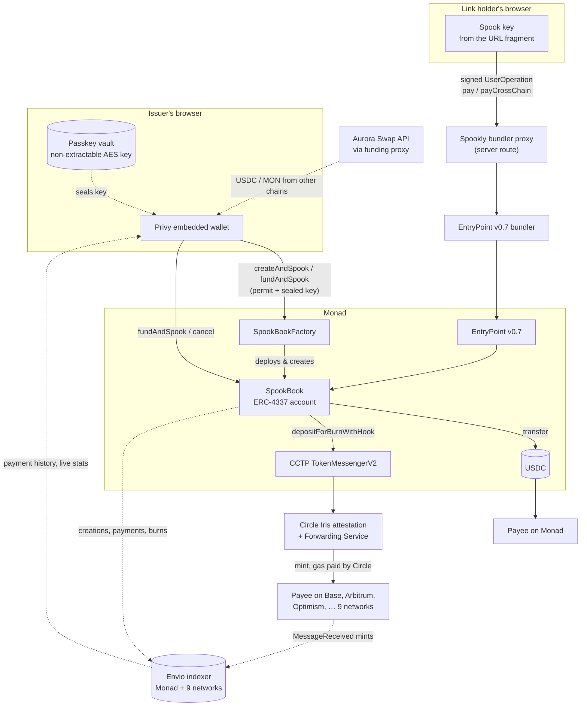
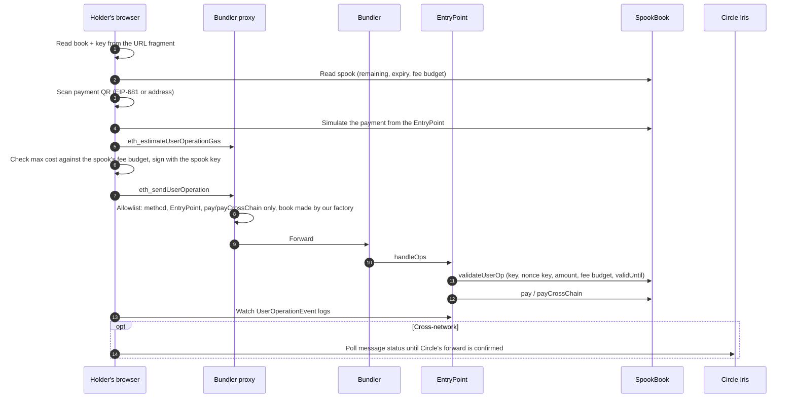

# Spookly — Spendable links

**Put USDC in a link. Whoever holds the link can pay any USDC address straight from it, on Monad or nine other networks, with no app, no wallet and no gas.**

Spookly turns a USDC payment into a _spook_: an amount set aside on Monad, dated, capped and cancellable, and shared as a link or QR code. The holder scans a payment code, taps **Pay**, and the payee has the money in seconds. There's no wallet to set up, no gas to buy and nothing to claim.

**Live on Monad mainnet:** [app.spookly.xyz](https://app.spookly.xyz) · [spookly.xyz](https://spookly.xyz)

`Monad mainnet` · `ERC-4337 (EntryPoint v0.7)` · `Circle CCTP V2 + Forwarding Service` · `Passkeys (WebAuthn PRF)` · `Privy` · `Aurora` · `Envio`

---

## Contents

- [Why](#why)
- [What it does](#what-it-does)
- [How it works](#how-it-works)
  - [Architecture](#architecture)
  - [A spook is a key, not a wallet](#a-spook-is-a-key-not-a-wallet)
  - [The spook book: an ERC-4337 account per issuer](#the-spook-book-an-erc-4337-account-per-issuer)
  - [Writing a spook in one transaction](#writing-a-spook-in-one-transaction)
  - [Spending a link](#spending-a-link)
  - [Paying across networks with CCTP](#paying-across-networks-with-cctp)
  - [Passkey-backed links: one passkey, many keys](#passkey-backed-links-one-passkey-many-keys)
  - [Funding from other chains with Aurora](#funding-from-other-chains-with-aurora)
  - [Issuer accounts and Monad-safe transactions](#issuer-accounts-and-monad-safe-transactions)
  - [Payment history across ten chains with Envio](#payment-history-across-ten-chains-with-envio)
- [Security model](#security-model)
- [Supported networks](#supported-networks)
- [Deployment](#deployment)
- [Tech stack](#tech-stack)
- [Running locally](#running-locally)
- [Testing](#testing)
- [License](#license)

---

## Why

Sending stablecoins to someone who isn't a crypto user usually means a _claim link_: the recipient creates a wallet, claims the funds into it, then sends them on again. Someone pays for gas, a payee on another network is out of reach, and whatever isn't spent sits in a wallet that may never be opened again.

Spookly removes the claiming step. **The link itself pays.**

|                          | Typical claim link                               | Spookly spendable link                         |
| ------------------------ | ------------------------------------------------ | ---------------------------------------------- |
| Before it's usable       | Set up a wallet or passkey to claim it           | Nothing to set up. The link already pays       |
| Paying someone           | Claim it, then send it again from the new wallet | Scan their payment code, tap Pay               |
| Payee on another network | Stuck on the network it was sent on              | Delivered on 10 networks through Circle CCTP   |
| Gas                      | Someone funds or sponsors the new wallet         | Paid from the issuer's capped fee allowance    |
| Money left over          | Sits in a wallet that may never be opened again  | Cancel any time; it returns in one transaction |
| If the link leaks        | Whoever claims first takes everything            | Capped, dated and cancellable until spent      |

## What it does

**For the issuer** (signs in with Google, email or a wallet):

1. **Spook.** Enter an amount and a lifetime (1, 7 or 30 days). One transaction escrows the USDC, tops up the fee allowance and creates the spook.
2. **Share.** Copy the link, use the share sheet, or show its QR code.
3. **Manage.** Watch each spook's balance and payments, cancel it to get unspent USDC and fees back, and browse past spooks in History.
4. **Fund.** Send and receive USDC on Monad, or top up USDC and MON from another chain through Aurora.
5. **Restore anywhere.** With a passkey enabled, every link is backed up on-chain in encrypted form and reopens on any device the passkey syncs to.

**For the person holding the link** (no account, no app):

1. Open the link. It goes straight to the camera and shows the spook's balance and expiry.
2. Scan a USDC payment QR code, or enter an address and pick its network.
3. Check the amount and fee, then tap **Pay**. Progress is shown live until the payee has the funds: about 10 seconds on Monad, 15–30 seconds elsewhere.

## How it works

### Architecture



No Spookly backend holds funds or keys. The server code is a few narrow relays, each keeping an API key private: the bundler proxy, the Aurora funding proxy, and a HyperSync receipt lookup.

### A spook is a key, not a wallet

Creating a spook generates a fresh secp256k1 key in the issuer's browser. The key's **address** is registered on-chain as the spook's identifier, with its amount, expiry and fee budget. The **key** goes into the link:

```
https://app.spookly.xyz/spook#<spook book address>.<spook key>      (both base64url-encoded)
```

Browsers never send the URL fragment (everything after `#`) to a server, so the key travels only from the issuer's device to the holder's, through whatever channel the issuer picks.

The key is deliberately weak. It can't hold funds or call arbitrary contracts. It can only authorize a payment from its own spook, up to the remaining balance, before expiry and within its fee budget.

### The spook book: an ERC-4337 account per issuer

Each issuer gets one **SpookBook**, a minimal ERC-4337 smart account holding the escrowed USDC for all their spooks. Payments arrive as UserOperations, and `validateUserOp` enforces the spook rules before any gas is spent:

- **Only payments.** The call data must be `pay(signer, recipient, amount)` or `payCrossChain(signer, domain, recipient, amount, maxFee)`, with no `initCode` and no paymaster.
- **The right key.** The operation must be signed (EIP-191 over the `userOpHash`) by the spook named in the first argument.
- **Per-spook nonces.** The nonce key (upper 192 bits) must equal the spook's address, so spooks spend in parallel and a signature can't be replayed against another spook.
- **Expiry without timestamps.** ERC-7562 forbids reading `block.timestamp` during validation, so expiry is returned as `validUntil` and enforced by the EntryPoint.
- **Fee fencing.** The operation's maximum cost, `(verificationGasLimit + callGasLimit + preVerificationGas) × maxFeePerGas`, must fit the spook's `gasLeft` budget and is charged against it. Operations that would certainly fail are rejected during validation, so a holder can't drain the budget with failing requests.

Gas comes from the book's EntryPoint deposit, never from the holder. The book tracks `reserved` (USDC escrowed by live spooks; the rest is the issuer's `available()` balance) and `committedGas` (fee budget still owed to live spooks; the rest is refunded on cancel).

| Function        | Who can call it        | What it does                                                                           |
| --------------- | ---------------------- | -------------------------------------------------------------------------------------- |
| `fundAndSpook`  | Issuer                 | Tops up the fee deposit, pulls only the USDC shortfall (via permit), creates the spook |
| `spook`         | Issuer or factory      | Registers a spook against already-available USDC                                       |
| `cancel`        | Issuer                 | Ends a spook, refunds unspent USDC and any spare fee deposit                           |
| `pay`           | EntryPoint (spook key) | Transfers USDC to an address on Monad                                                  |
| `payCrossChain` | EntryPoint (spook key) | Burns USDC through CCTP for delivery on another network                                |
| `list`          | Anyone                 | Returns every spook with its state and sealed key                                      |

A spook address can be created only once, so a cancelled link can never become spendable again.

### Writing a spook in one transaction

- **First spook.** `SpookBookFactory.createAndSpook` deploys the issuer's book, pulls the USDC with an **EIP-2612 permit**, deposits the fee allowance (`msg.value`) and creates the spook.
- **Later spooks.** `SpookBook.fundAndSpook` pulls only the shortfall against the available balance, and tops up the fee deposit only when the spare deposit is below the per-spook allowance (0.3 MON).
- **Front-run permits.** If someone else submits the permit first, the contract falls back to the allowance it created.
- **Key saved first.** The spook key is stored on the issuer's device before the transaction is sent, so a confirmed spook never ends up without its link.

### Spending a link



- **Payment codes.** Plain addresses and EIP-681 requests (`ethereum:<token>@<chainId>/transfer?address=…&uint256=…`), including scientific-notation amounts. Non-USDC codes get a warning; unsupported chains prompt for a network.
- **Checks before signing.** The payment is simulated from the EntryPoint and its maximum cost checked against the spook's fee budget and the book's deposit, so problems show as plain-language messages instead of failed transactions.
- **Fees.** Built with viem's account-abstraction tools, with a 50% base-fee buffer and a priority fee 20% above the bundler's quote.
- **Bundler proxy.** Relays only bundler methods, only for EntryPoint v0.7, and only `pay`/`payCrossChain` from books the factory created (checked on-chain with `bookOf(owner) == sender`). Bundler errors such as AA21, AA22 and AA24 become readable messages.
- **Confirmation.** The app reads `UserOperationEvent` logs directly in 100-block windows, independent of the bundler, and a payment in progress survives reloads. If the scan falls more than a window behind, a server route asks Envio HyperSync for the event across the gap in one request; without HyperSync, the RPC scan does everything.

### Paying across networks with CCTP

For payees on another network, `payCrossChain` calls Circle's **TokenMessengerV2** `depositForBurnWithHook`:

| Parameter           | Value                                                                                                                             |
| ------------------- | --------------------------------------------------------------------------------------------------------------------------------- |
| Finality            | Standard (`minFinalityThreshold = 2000`). Monad attests in about a block, and standard transfers from Monad carry no protocol fee |
| Hook data           | `"cctp-forward"`, invoking Circle's **Forwarding Service**: Circle submits the destination mint, so no relayer or payee gas       |
| `destinationCaller` | Zero, so the forwarder can complete the mint                                                                                      |
| `maxFee`            | The median forwarding fee quoted by Iris (`/v2/burn/USDC/fees/15/<domain>?forward=true`)                                          |

The spook burns `amount + fee`, so **the payee receives exactly the amount requested**, and the holder sees the fee before paying. The app then polls Iris (`/v2/messages/15?transactionHash=…`) until the forward lands and links to the mint on the destination explorer.

Example (testnet): a spook paid **0.50 USDC** from Monad to **Base Sepolia** with a 0.063284 USDC forwarding fee, burn to mint in **about 15 seconds**, **0 MON** paid by the holder ([burn](https://testnet.monadexplorer.com/tx/0x46309070f65d48d8574d28098e5f37458fa24d6becaa999ddd9a2738d0fa27a3), [mint](https://sepolia.basescan.org/tx/0xa4120e50e6ee672e427dcdf3e2348102bc190b8ce509aed21f8fe924b8fc5446)).

### Passkey-backed links: one passkey, many keys

A link's key normally lives only on the device that wrote it. Spookly uses the **WebAuthn PRF extension** (through Category Labs' Mera) so one passkey protects every link:

1. **Derive.** PRF with the app salt `SHA-256("spookly.v1.spook-links")` yields a 32-byte secret, identical on every device the passkey syncs to.
2. **Split.** HKDF-SHA256 turns it into an **AES-GCM-256 sealing key** (imported as a _non-extractable_ `CryptoKey` and kept in IndexedDB, so creating spooks needs no further prompts) and a **64-bit key id** that tells passkeys apart. The PRF output is zeroed straight after.
3. **Seal.** Each new spook key is encrypted as `version (1) | key id (8) | nonce (12) | ciphertext + tag (48)` (69 bytes) and stored on-chain with the spook in the same transaction. Every seal is decrypted and checked before sending.
4. **Restore.** On a new device, one passkey prompt rederives the vault and opens **every** live spook sealed with that key id. Each decrypted key must control its spook's address before it's accepted.

| Situation                           | Behaviour                                                                                                      |
| ----------------------------------- | -------------------------------------------------------------------------------------------------------------- |
| Wrong passkey chosen                | Refused, because its key id matches none of the book's seals                                                   |
| Prompt cancelled or timed out       | Clear message, with the option to try again or create a new passkey                                            |
| Passkey lost                        | Create a new one for future spooks. Links locked to the old one can still be cancelled for a full refund       |
| Browser without PRF support         | Detected before a passkey is created, so no unusable passkey is left behind                                    |
| Corrupted local key or stored vault | Discarded and recovered from the on-chain seal                                                                 |
| Sign-out                            | The vault and every backed-up key are wiped from the device. Keys without a backup are kept so no link is lost |

### Funding from other chains with Aurora

When the wallet is short of USDC, or of MON for the fee allowance, Spook offers **Top up from another chain**; Receive offers the same under **From another chain**. Both use Aurora's [Swap API](https://docs.intents.aurora.dev/intents-swap/what-is-swap-api) headlessly through a server route that keeps `AURORA_API_KEY` private.

- **Constrained quotes.** The route allows only exact-output quotes to the issuer's own wallet for native Monad USDC or MON, validated by chain and token address, and checks each returned quote before showing it.
- **Paying.** EVM sources pay from the connected wallet, which switches chains only for the transfer. Other chains use the quote's deposit address and memo.
- **Recovery.** Sessions are saved before any payment and resume after a reload. Partial deposits, failed swaps and refunds never trigger spook creation. No spook key is sent to Aurora.

### Issuer accounts and Monad-safe transactions

- **Privy sign-in.** Google, email or an existing wallet. Email and social sign-ins create an embedded wallet with no seed phrase. Wallet pop-ups are disabled; the app's own buttons are the confirmation. Authenticator-app wallet MFA is optional via **Protect wallet**.
- **Gas checks for Monad.** Monad charges gas by the gas _limit_, and includes a transaction that can afford its gas but not its value, then reverts it. Every issuer transaction is therefore estimated as if funded (a balance state override, since Monad refuses to estimate a short balance), and value plus `gasLimit × maxFeePerGas` is checked against the real balance before signing.
- **Live balances.** Wallet and spook balances refresh every 10 seconds and when the tab regains focus.
- **Wallet screens.** Receive USDC and MON, and send USDC to any address on Monad or, through CCTP forwarding, the nine other networks.

### Payment history across ten chains with Envio

The contracts hold each spook's current state but not its history. An **Envio HyperIndex** indexer follows the spook books on Monad and Circle's CCTP MessageTransmitterV2 on all nine destination networks:

- **Spook books.** `BookCreated` registers each book as a dynamic contract; `SpookCreated`, `SpookCancelled`, `Paid` and `PaidCrossChain` become `Book`, `Spook` and `Payment` entities.
- **Deliveries proven on the destination.** Every CCTP mint emits `MessageReceived` with the original burn message, naming the paying book, the payee, the amount burned and the fee Circle took. A payment is marked delivered when its mint is indexed, without relying on Circle's API.
- **Burns and mints in either order.** Chains are indexed independently, so each side waits under a shared key (book, domain, payee, amount) until its counterpart arrives.
- **Live totals.** A `Stats` entity feeds the landing page's spooks created, USDC paid out and cross-network deliveries.

Each spook's page lists its payments with status (paid, on its way, delivered) and explorer links. On mainnet all ten chains sync through HyperSync. The indexer is optional: without `NEXT_PUBLIC_ENVIO_GRAPHQL_URL` the app works without payment lists and live stats.

## Security model

| Threat                                        | Mitigation                                                                                                                  |
| --------------------------------------------- | --------------------------------------------------------------------------------------------------------------------------- |
| A link leaks                                  | It can only spend its own capped escrow before its expiry, and the issuer can cancel it instantly                           |
| Holder tries to overspend                     | The remaining balance is checked, and validation rejects the operation before any fee is charged                            |
| Holder floods failing operations to burn fees | Validation rejects operations that would fail, and each spook's fee budget is capped separately                             |
| Signature replay                              | The nonce key is bound to the spook's address; each spook has its own sequence                                              |
| Cancelled link reused                         | A spook address can be registered only once                                                                                 |
| Server compromise                             | Keys live in URL fragments and never reach the server. The relay forwards only `pay`/`payCrossChain` for factory-made books |
| Sealed keys are public on-chain               | AES-GCM under a key that only the issuer's passkey can rederive. Each opened key must match its spook's address             |
| Issuer funds                                  | Only the issuer can create, fund or cancel. A spook key can't move anything outside its own spook                           |

## Supported networks

| Network     | Chain ID | CCTP domain | Route                     |
| ----------- | -------- | ----------- | ------------------------- |
| Monad       | 143      | 15          | Direct USDC transfer      |
| Base        | 8453     | 6           | CCTP + Forwarding Service |
| Arbitrum    | 42161    | 3           | CCTP + Forwarding Service |
| Optimism    | 10       | 2           | CCTP + Forwarding Service |
| Polygon     | 137      | 7           | CCTP + Forwarding Service |
| Avalanche   | 43114    | 1           | CCTP + Forwarding Service |
| Unichain    | 130      | 10          | CCTP + Forwarding Service |
| Linea       | 59144    | 11          | CCTP + Forwarding Service |
| World Chain | 480      | 14          | CCTP + Forwarding Service |
| Ethereum    | 1        | 0           | CCTP + Forwarding Service |

A testnet build swaps in Monad testnet (10143) and each network's test chain. Both profiles are in `config/networks.json`.

## Deployment

| Component        | Where                                                                                                                                                     |
| ---------------- | --------------------------------------------------------------------------------------------------------------------------------------------------------- |
| Site and app     | Vercel, deployed from `main`. `spookly.xyz` serves the landing page, `app.spookly.xyz` the app, with links at `/spook`                                    |
| SpookBookFactory | Monad mainnet, [`0xe10fae40a38a35d25fd6e01819a9bd285307f396`](https://monadscan.com/address/0xe10fae40a38a35d25fd6e01819a9bd285307f396) (block 113140121) |
| Indexer          | Envio hosted service, `spookly-mainnet`, deployed from the `envio-mainnet` branch                                                                         |
| Testnet factory  | Monad testnet, [`0xd93f67d2735e3af22e699d65aeaa6147db2c9214`](https://testnet.monadexplorer.com/address/0xd93f67d2735e3af22e699d65aeaa6147db2c9214)       |

Factory records are in `config/deployments/`. Each issuer's SpookBook is created with their first spook and resolves with `bookOf(issuer)`.

Production sets `NEXT_PUBLIC_SPOOKLY_NETWORK=mainnet`, `NEXT_PUBLIC_PRIVY_APP_ID`, `BUNDLER_RPC_URL`, `AURORA_API_KEY`, `NEXT_PUBLIC_ENVIO_GRAPHQL_URL` (the hosted indexer) and `ENVIO_API_TOKEN` in Vercel. `NEXT_PUBLIC_*` values are embedded at build time, so redeploy after changing them.

## Tech stack

| Layer       | Technology                                                                      |
| ----------- | ------------------------------------------------------------------------------- |
| Contracts   | Solidity 0.8.30, Foundry, OpenZeppelin, eth-infinitism account-abstraction v0.7 |
| Chain       | Monad mainnet, ERC-4337 EntryPoint v0.7                                         |
| Cross-chain | Circle CCTP V2, Forwarding Service, Iris API                                    |
| Funding     | Aurora Swap API (intents)                                                       |
| App         | Next.js 16 (App Router), React 19, viem (incl. account abstraction)             |
| UI          | Tailwind CSS v4, shadcn/ui on Base UI, React view transitions                   |
| Accounts    | Privy (Google, email, external wallets, embedded wallets)                       |
| Passkeys    | WebAuthn PRF through Mera, Web Crypto (HKDF, AES-GCM), IndexedDB                |
| Indexing    | Envio HyperIndex v3 and HyperSync, multichain with dynamic contracts, GraphQL   |
| Hosting     | Vercel (app), Envio hosted service (indexer)                                    |

## Running locally

**Prerequisites:** Node.js 22+, pnpm, and [Foundry](https://getfoundry.sh) for the contracts.

```bash
pnpm install
cp .env.example .env.local
pnpm dev                       # http://localhost:3000, app at /app
```

Mainnet is the default; set `NEXT_PUBLIC_SPOOKLY_NETWORK=testnet` for the testnet deployment, then restart. Add your origin to the Privy app. `BUNDLER_RPC_URL` must be an EntryPoint 0.7 bundler for the selected network; an ordinary RPC can't submit user operations.

`proxy.ts` splits the site and app by host and redirects old `/app` and `/spook` URLs on the site to the app host. In development and on preview deployments the app stays under `/app`, because Privy's embedded wallet needs HTTPS or plain `localhost`.

| Variable                                      | Needed for                      | Description                                                              |
| --------------------------------------------- | ------------------------------- | ------------------------------------------------------------------------ |
| `NEXT_PUBLIC_SPOOKLY_NETWORK`                 | Environment                     | `mainnet` (default) or `testnet`; shared by the app and tooling          |
| `NEXT_PUBLIC_PRIVY_APP_ID`                    | App                             | Privy app ID for issuer sign-in                                          |
| `BUNDLER_RPC_URL`                             | Payments                        | EntryPoint 0.7 bundler for the selected Monad network                    |
| `AURORA_API_KEY`                              | Cross-chain funding             | Server-side [Aurora Studio](https://studio.aurora.dev) key; mainnet only |
| `NEXT_PUBLIC_ENVIO_GRAPHQL_URL`               | Optional                        | Indexer endpoint for the selected network                                |
| `ENVIO_API_TOKEN`                             | Optional                        | Server-only HyperSync token for confirming payments after a reload       |
| `MONAD_RPC_URL`, `NEXT_PUBLIC_MONAD_RPC_URL`  | Optional                        | RPC overrides; must serve the selected network                           |
| `NEXT_PUBLIC_SITE_URL`, `NEXT_PUBLIC_APP_URL` | Optional                        | Site and app origins; default to `spookly.xyz` and `app.spookly.xyz`     |
| `ALCHEMY_API_KEY`                             | Testnet payments                | Fallback bundler when `BUNDLER_RPC_URL` is unset on testnet              |
| `DEPLOYER_PRIVATE_KEY`                        | Contract deployment, smoke test | Funded key, kept in ignored `.env.deploy.local`                          |

On testnet, get funds from the [Circle USDC faucet](https://faucet.circle.com) and [Monad faucet](https://faucet.monad.xyz).

**Contracts:**

```bash
pnpm contracts:test      # Foundry tests on a fork of the selected Monad network
pnpm contracts:build     # compile and regenerate lib/abi.ts
pnpm contracts:deploy    # read-only network and dependency checks
pnpm contracts:deploy --broadcast --max-fee 0.5   # deploy and record the factory, within a MON gas budget
```

Every broadcast needs an explicit `--max-fee`. Commit the public record written to `config/deployments/`, then rebuild the app.

**Indexer:** needs Docker and an [Envio API token](https://envio.dev/app/api-tokens).

```bash
pnpm indexer:install
echo "ENVIO_API_TOKEN=<your token>" > indexer/.env
pnpm indexer:dev         # mainnet GraphQL on :8081, testnet on :8080
```

Then set `NEXT_PUBLIC_ENVIO_GRAPHQL_URL` to `http://localhost:8081/v1/graphql` (mainnet) or `http://localhost:8080/v1/graphql` (testnet). The command generates `indexer/config.generated.<network>.yaml` from the deployment record; mainnet destination start blocks are pinned in `config/deployments/mainnet-indexer.json`.

To redeploy the hosted indexer, regenerate `config.generated.mainnet.yaml` with `pnpm indexer:codegen` if the factory changed, commit it, and run `git push origin main:envio-mainnet`. Each deployment re-indexes from the start blocks while the previous one keeps serving. If the GraphQL endpoint changes, update `NEXT_PUBLIC_ENVIO_GRAPHQL_URL` in Vercel and redeploy the app.

**Local testnet fork:** with `NEXT_PUBLIC_SPOOKLY_NETWORK=testnet`, run `anvil --fork-url https://testnet-rpc.monad.xyz`, deploy with `--broadcast` and `MONAD_RPC_URL=http://127.0.0.1:8545`, start the bundled bundler with `pnpm dev:fork`, and point `MONAD_RPC_URL`, `NEXT_PUBLIC_MONAD_RPC_URL` at anvil and `BUNDLER_RPC_URL` at `http://localhost:4337`.

**Testnet gas sponsorship:** issuer transactions can be sponsored through Privy on Monad testnet only; mainnet ignores the setting. Configure Privy TEE wallets with sponsorship for Monad Testnet and **Allow transactions from the client** off, create an Upstash Redis database with eviction disabled, and set `PRIVY_GAS_SPONSORSHIP=true`, `PRIVY_APP_SECRET`, `UPSTASH_REDIS_REST_URL` and `UPSTASH_REDIS_REST_TOKEN` server-side. `lib/server/sponsor-policy.ts` caps it at five reservations per wallet and per user per UTC day, and 100 across the app.

**Installable spender:** `/spook` advertises a PWA manifest. Use **Install app** in Chromium or **Share → Add to Home Screen** in Safari; the installed app opens an **Open spook** form for pasting a link. It needs a connection and has no service worker.

## Testing

| Command                       | What it covers                                                                                                                                                                                                                                                              |
| ----------------------------- | --------------------------------------------------------------------------------------------------------------------------------------------------------------------------------------------------------------------------------------------------------------------------- |
| `pnpm contracts:test`         | 16 Foundry tests on a fork of the selected network: one-transaction creation, shortfall-only funding, sealed keys, Monad and CCTP payments, per-spook nonces, wrong-key and overspend rejection before fees, cancellation refunds, expiry, issuer guards, delegated wallets |
| `pnpm test`                   | Unit suites run under both testnet and mainnet: Aurora quotes and funding, network isolation, host routing, HyperSync receipts, spook recovery, sponsorship, and the passkey vault (derivation, tampering, wrong passkey, multi-link restore, sign-out)                     |
| `pnpm test:sponsorship`       | Sponsorship limits against an isolated Redis in Docker                                                                                                                                                                                                                      |
| `pnpm --dir indexer test`     | Indexer: decoding a real CCTP burn message, matching burns to mints across chains, domain mapping                                                                                                                                                                           |
| `pnpm smoke`                  | End to end on the selected network: creates a spook, pays 0.5 USDC to Base through the bundler and waits for Circle's forwarder. Mainnet requires `--broadcast` and spends real funds                                                                                       |
| `pnpm typecheck`, `pnpm lint` | TypeScript and ESLint                                                                                                                                                                                                                                                       |

## License

Copyright 2026 mcxross. Licensed under the [Apache License 2.0](LICENSE).
